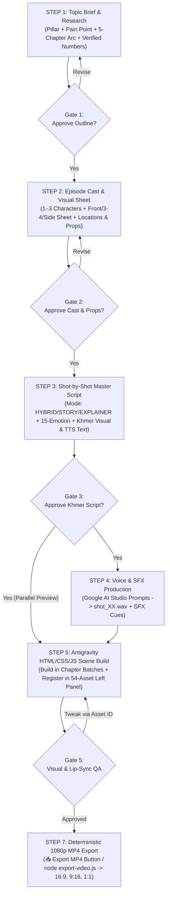

# Episode Production Workflow & Working Rules (SOP v2.0)

This document defines the step-by-step production pipeline and approval gates between **You (Producer/Reviewer)**, **Gemini (Researcher, Writer & Director)**, **Google AI Studio (Voice & SFX Generation)**, and **Antigravity (HTML/CSS/JS 2D Animation Engine & Deterministic MP4 Exporter)**.

---

## End-to-End Production Flowchart



---

## Detailed Step-by-Step Working Rules

### STEP 1 — Deep Topic Brief & Fact Research (`01_topic_brief.md`)
- **Input:** You select one of the 4 Topic Pillars and a target question/problem.
- **Gemini's Task:**
  - Research comprehensive, deeply meaningful facts, mechanisms, percentages, and real-life Cambodian examples (e.g., `$300` monthly salary, `70–85%` pawn LTV, `50/30/20` rule, or multi-organ metabolic/neurological pathways).
  - **Depth-First Rule (No Arbitrary Time Cap):** Never compress a story into a shallow summary. Structure a **complete, deep narrative arc** divided into **5–7+ Chapters** covering the everyday hook, root cause, immediate mechanisms, hidden secondary traps, long-term compounding effects, real-life turnaround, and actionable step-by-step protocol.
- **Gate 1 Rule:** *Never write full dialogue until you approve the deep chapter outline and verified educational benchmarks.*

---

### STEP 2 — Episode Cast & Visual Asset Sheet (`02_character_and_prop_sheet.md`)
- **Input:** Approved Chapter Outline from Step 1.
- **Gemini & Antigravity's Task:**
  - Design **1–3 Episode-Specific Characters** (Name in Khmer, Role, Minimalist vs. Outfitted torso, Hair, Wardrobe Accent Color, Voice ID `VOICE-CAST-01..03`).
  - Render the interactive **Episode Character Sheet** (`Front 0°`, `3/4 View`, `Side 90°` + core expressions + episode poses) and register the cast in the **Left Sidebar Asset Library (`char:...`)**.
  - Select the **2–4 Locations** (from our 12 reusable locations) and define any **Hero Props** (`prop:...`) needed for the episode.
- **Gate 2 Rule:** *Lock character designs and hero props once in Step 2 so proportions, outfits, and colors remain 100% identical across all shots.*

---

### STEP 3 — Master Script & Shot-by-Shot Storyboard (`03_shot_script.md`)
- **Input:** Approved Cast & Outline.
- **5-Part Filmmaker Narrative Flow:** Every episode script must weave together:
  1. **`INTRO` (Cold Open, Title Card & Curiosity Hook)**
  2. **`EXAMPLE STORY` (Relatable Character Drama & Everyday Conflict)**
  3. **`B-ROLL & MACRO CUTAWAYS` (Dynamic Visual Metaphors & Internal Mechanism Cutaways every `8–12s`)**
  4. **`MAIN EXPLAINER & HOW-TO PROTOCOL` (Deep Scientific/Financial Knowledge + Step-by-Step Action Plan)**
  5. **`OUTRO` (Transformation Payoff, Golden Takeaway & Subscribe/Share CTA)**
- **Working Batch Size & Narrative Depth:** We work **Chapter by Chapter** so review stays focused, writing **rich, complete spoken Khmer narration (`2–4` full sentences per shot)** that thoroughly explains the story, mechanism, and human impact without rushing.
- **Every Shot Specification Includes:**
  1. **Shot ID, Director Section, Mode & Transition:** `directorSection` (`INTRO`, `STORY`, `B-ROLL`, `EXPLAINER`, `HOW-TO`, `OUTRO` — planning metadata only; it is **not rendered** as an on-stage ribbon), Mode (`STORY`, `EXPLAINER`, `HYBRID`), Camera Framing (`Wide`, `Medium`, `Close-Up`), and Scene Transition (`wipe` — `1.18s` wavy ink wipe, `iris` — `1.10s`, `dissolve` — `1.02s`).
  2. **Three-Layer Visuals + B-Roll Cutaway:**
     - `ENVIRONMENT`: Location ID + background/foreground props.
     - `CHARACTER`: Actor ID, Angle (`front`/`3-4`/`side`), Emotion (`actorBeats` from the **15-Emotion Matrix**), and Motion/Gesture (`point`, `walk`, `sit`, `sad-droop`, `open-welcome`, `jump-celebrate`, etc.).
     - `EXPLANATION + B-ROLL`: Floating "គិតមើល" info cards (`data-reveal-at`, `data-dock-at`) + **Animated 2D B-Roll Cutaway Window** (`data-broll-window="start,end"`) so visual interest stays high throughout the shot.
  3. **Dual Khmer Script Columns & 3-Stem Sound Design:**
     - **Column A — Visual Subtitle & Labels (`captionBeats`):** Crisp 1–2 line Khmer subtitle per sentence + exact digits (`$300`, `70-85%`).
     - **Column B — Google AI Studio TTS Script:** Natural spoken Khmer with numbers/symbols spelled out in Khmer words (`បីរយដុល្លារ`, `ចិតសិបទៅប៉ែតសិបប្រាំភាគរយ`) and breath pauses (`...`, `។`).
     - **3-Stem Audio Mix:** `VOICE-NARRATOR-001` (`0 dB`) + Continuous `BGM` (`bgmMood: curious | story | investigation | uplifting`, auto-ducked to `-18 dB`) + Location Ambience & Point SFX (`sfxCues`).
- **Gate 3 Rule:** *One learning idea per shot. You review and approve the Khmer wording before you generate voice files in Google AI Studio.*

---

### STEP 4 — Voice & SFX Generation (`04_ai_studio_voice_prompts.md`)
- **Input:** Approved Shot Script from Step 3.
- **Unified Studio Voice Rule (`VOICE-NARRATOR-001`):**
  - By default, all episodes and all shots use **one unique, custom-designed vocal persona (`VOICE-NARRATOR-001` — Khmer 2D Studio Narrator)** created once in **Google AI Studio Voice Design (`gemini-3.8-flash-tts`)**, with situational `[STYLE]` tags steering emotional shifts across hooks, character quotes, warnings, and summaries.
- **Your Task in Google AI Studio:**
  - Generate the voice audio using your saved `VOICE-NARRATOR-001` voice and save as `episodes/epXX/audio/voice/shot_01.wav` (or `.mp3`), `shot_02.wav`, etc.
- **Gate 4 Rule (Audio-Driven Timing):**
  - *Before audio files exist:* The HTML scene player uses estimated reading duration (`defaultDuration`) so you can preview animations immediately.
  - *Once `shot_XX.wav` is added:* Both the live HTML scene player and the deterministic MP4 exporter (`export-video.js`) automatically lock the shot's duration and lip-sync envelope to the exact length and waveform of `shot_XX.wav`!

---

### STEP 5 — Antigravity HTML/CSS/JS Scene Build (`episodes/epXX/scenes.js`)
- **Input:** Approved Shot Script (and `.wav` files when ready).
- **Antigravity's Task:**
  - Build the playable HTML/CSS/JS scene show in **Chapter Batches (`8–12` shots at a time)**.
  - Register all episode elements (`elem:...`), props (`prop:...`), B-Roll items (`item:...`), cast (`char:...`), and shot usage (`ASSET_SHOT_USAGE`) in the **Left Sidebar Asset Library** (`engine/scene-player.js`) so every asset can be inspected individually and referenced by ID (`📋 Copy ID`).
  - Wire the **Right Sidebar Active Shot Inspector** (`1. Active Shot & Used Assets`, `2. Khmer Subtitle Beats`, `3. Voice-Over VOICE-NARRATOR-001`).

---

### STEP 6 — Visual & Lip-Sync QA Checklist (`http://localhost:8080`)
Before exporting final MP4 files, verify:
1. **Direct Asset Inspection & Refinement:** Click any item in the Left Sidebar (`54+` Assets) to inspect it on stage. Click **`📋 Copy ID`** on any element, prop, or character and tell Antigravity what to adjust.
2. **Coordinated Emotion & Gated Character Lip-Sync (`actor.speakWindows`):** Character mouth lip-sync (`mouthOpen`) and character dialog info boxes (`.ref-speech-bubble` with `data-speak-window="start,end"`) must **only activate during the exact time window when that character speaks (`start <= elapsed <= end` while voice plays)** and hide (`opacity: 0`) when the character finishes speaking or playback stops.
3. **Voice-Dependent Running Subtitle Caption (`#stageCaptionText`):** The bottom Khmer subtitle bar (`#3B3B3B` pill) must **only be visible while voice sound is actively playing (`.voice-active`)** and must progressively highlight spoken words across each `captionBeat`.
4. **Unhurried Scene-to-Scene Transitions:** Each shot holds a `550ms` natural breathing pause at the end of the voice track before triggering the `1.18s` wavy ink wipe (`1.10s` iris / `1.02s` dissolve) into the next shot.

---

### STEP 7 — Deterministic 1080p MP4 Export & Multi-Platform Delivery
- **Option A — 1-Click Studio UI Exporter (`📥 Export MP4`):**
  1. Click **`📥 Export MP4`** in the Top Header, Bottom Timeline Bar, or Theatre HUD at `http://localhost:8080`.
  2. Choose **Current Active Shot Only** (for fast QA) or **Full Episode (All Story Shots + Transitions)**.
  3. Select Aspect Ratio (`16:9` `1920×1080`, `9:16` `1080×1920` TikTok, or `1:1` `1080×1080` Facebook) and Frame Rate (`30 FPS` or `60 FPS`).
  4. Click **`🚀 Start MP4 Render`** and click **`⬇ Download MP4`** when complete (files are also saved to `exports/`).
- **Option B — Command-Line Exporter (`export-video.js`):**
  ```powershell
  # Export single shot
  node export-video.js --deck ep02 --shot 1 --aspect 16:9 --fps 30

  # Export full episode in 1080p60 (16:9 YouTube/Facebook)
  node export-video.js --deck ep02 --aspect 16:9 --fps 60

  # Export vertical 9:16 TikTok/Reels master
  node export-video.js --deck ep02 --aspect 9:16 --fps 30
  ```
- **Option C — Live Theatre Capture (`🎥 Theatre Capture`):** Full-screen black-frame playback for live OBS screen recording if desired.


---
## SOP v2.1 Addendum — Fact-Check, Story-Mix & Multi-Cast Voice (from EP02)
- **Step 1:** add a claim→verdict→safe-wording table with sources; remove unsourced numbers; add a health safety line.
- **Step 3:** write the script per line (`# | Voice | Beat | Spoken Khmer | On-screen`), ≥ 3 beat types per shot (`STORY/PROBLEM/DIALOGUE/EXAMPLE/SOLUTION/HOOK`), narrator ≤ 30%.
- **Step 4 (Multi-Cast Mode, on request):** one TTS call per line → `audio/voice/shot_XX/line_NN_<speaker>.wav`; `04_ai_studio_voice_prompts.md` is generated from the shot data.
- **Step 5–6:** line-bound reveals (`data-reveal-line`, `data-speak-line`, …); run the headless 3-aspect overlap audit before QA sign-off.
- **Step 7:** export mixes the per-line files; timing comes from real audio lengths.


## Current package workflow

EP02 is the sole installed episode. Follow [the episode architecture contract](./EPISODE_ARCHITECTURE.md). Scaffold planning files with `npm run episode:new -- ep03-topic-slug`, record real gate evidence in `production.json`, and keep topic visuals in episode-owned modules. Audio uses per-line files for EP02; use the existing multi-cast voice mode. Run validation and all-format QA before final export. Do not treat file existence or missing-audio previews as production approval.

### Speaker-dialogue QA

- Apply speaker anchoring to every production shot in all three output formats. Position dialogue close above the actual speaker after camera framing; account for seated poses, actor scale and camera zoom/pan. Keep off-screen dialogue explicitly labelled with no tail.
- Fit concept panels around the dialogue/cast area rather than moving speech boxes away from speakers. Check long lines, name tags, text overflow and faces manually as well as with the layout audit. EP02's manifest `anchorDialogue` hook is the integration reference; invent new episode visuals instead of copying its content.

- In the script, identify each character line's speaker and indicate phone dialogue explicitly in the speaker label when applicable.
- During scene build, render the matching cast portrait and Khmer name on each dialogue bubble. On-stage speakers have a tail; off-screen speakers show `ក្រៅឆាក`, or a `☎` phone label, with no tail. Portraits are static identity markers.
- Keep bubbles bound to `data-speak-line`, hide narrator captions during character dialogue, and lip-sync only the speaking on-stage actor.
- Review all three formats for readable text, unclipped portraits/tags, concept-card collisions and tail placement. Run `npm run qa:layout -- --serve`, then inspect screenshots: rectangle checks alone cannot establish speaker association or audio synchronization.
