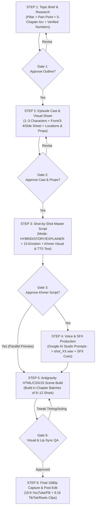

# Episode Production Workflow & Working Rules (SOP v2.0)

This document defines the step-by-step production pipeline and approval gates between **You (Producer/Reviewer)**, **Gemini (Researcher, Writer & Director)**, **Google AI Studio (Voice & SFX Generation)**, and **Antigravity (HTML/CSS/JS 2D Animation Engine)**.

---

## End-to-End Production Flowchart

---

## Detailed Step-by-Step Working Rules

### STEP 1 — Deep Topic Brief & Fact Research (`01_topic_brief.md`)
- **Input:** You select one of the 4 Topic Pillars and a target question/problem.
- **Gemini's Task:**
  - Research comprehensive, deeply meaningful facts, mechanisms, percentages, and real-life Cambodian examples (e.g., `$300` monthly salary, `70–85%` pawn LTV, `50/30/20` rule, or multi-organ metabolic/neurological pathways).
  - **Depth-First Rule (No Arbitrary Time Cap):** Never compress a story into a shallow summary. Structure a **complete, deep narrative arc** divided into **5–7+ Chapters** covering the everyday hook, root cause, immediate mechanisms, hidden secondary traps, long-term compounding effects, real-life turnaround, and actionable step-by-step protocol.
- **Gate 1 Rule:** *Never write full dialogue until you approve the deep chapter outline and verified educational benchmarks.*

---

### STEP 2 — Episode Cast & Visual Asset Sheet (`02_character_and_prop_sheet.md`)
- **Input:** Approved Chapter Outline from Step 1.
- **Gemini & Antigravity's Task:**
  - Design **1–3 Episode-Specific Characters** (Name in Khmer, Role, Minimalist vs. Outfitted torso, Hair, Wardrobe Accent Color, Voice ID `VOICE-CAST-01..03`).
  - Render the interactive **Episode Character Sheet** (`Front 0°`, `3/4 View`, `Side 90°` + core expressions + episode poses).
  - Select the **2–4 Locations** (from our 12 reusable locations) and define any **Hero Props** needed for the episode.
- **Gate 2 Rule:** *Lock character designs and hero props once in Step 2 so proportions, outfits, and colors remain 100% identical across all 40–60 shots.*

---

### STEP 3 — Master Script & Shot-by-Shot Storyboard (`03_shot_script.md`)
- **Input:** Approved Cast & Outline.
- **5-Part Filmmaker Narrative Flow:** Every episode script must weave together:
  1. **`INTRO` (Cold Open, Title Card & Curiosity Hook)**
  2. **`EXAMPLE STORY` (Relatable Character Drama & Everyday Conflict)**
  3. **`B-ROLL & MACRO CUTAWAYS` (Dynamic Visual Metaphors & Internal Mechanism Cutaways every `8–12s`)**
  4. **`MAIN EXPLAINER & HOW-TO PROTOCOL` (Deep Scientific/Financial Knowledge + Step-by-Step Action Plan)**
  5. **`OUTRO` (Transformation Payoff, Golden Takeaway & Subscribe/Share CTA)**
- **Working Batch Size & Narrative Depth:** We work **Chapter by Chapter** so review stays focused, writing **rich, complete spoken Khmer narration (`2–4` full sentences per shot)** that thoroughly explains the story, mechanism, and human impact without rushing.
- **Every Shot Specification Includes:**
  1. **Shot ID, Director Section, Mode & Transition:** `directorSection` (`INTRO`, `STORY`, `B-ROLL`, `EXPLAINER`, `HOW-TO`, `OUTRO`), Mode (`STORY`, `EXPLAINER`, `HYBRID`), Camera Framing (`Wide`, `Medium`, `Close-Up`), and Scene Transition (`cinematic-wipe`, `iris-zoom`, `slide-push`, `cross-dissolve`).
  2. **Three-Layer Visuals + B-Roll Cutaway:**
     - `ENVIRONMENT`: Location ID + background/foreground props.
     - `CHARACTER`: Actor ID, Angle (`front`/`3-4`/`side`), Emotion (`actorBeats` from the **15-Emotion Matrix**), and Motion/Gesture (`point`, `walk`, `sit`, `sad-droop`, `open-welcome`, etc.).
     - `EXPLANATION + B-ROLL`: Floating bar/icon/speech bubble layout (`data-reveal-at`) + **Animated 2D B-Roll Cutaway Window** (`data-broll-window="start,end"`) so visual interest stays high throughout the shot.
  3. **Dual Khmer Script Columns & 3-Stem Sound Design:**
     - **Column A — Visual Subtitle & Labels (`captionBeats`):** Crisp 1–2 line Khmer subtitle per sentence + exact digits (`$300`, `70-85%`).
     - **Column B — Google AI Studio TTS Script:** Natural spoken Khmer with numbers/symbols spelled out in Khmer words (`បីរយដុល្លារ`, `ចិតសិបទៅប៉ែតសិបប្រាំភាគរយ`) and breath pauses (`...`, `។`).
     - **3-Stem Audio Mix:** `VOICE-NARRATOR-001` (`0 dB`) + Continuous `BGM` (`bgmMood: curious | story | investigation | uplifting`, auto-ducked to `-18 dB`) + Location Ambience & Point SFX (`sfxCues`).
- **Gate 3 Rule:** *One learning idea per shot. You review and approve the Khmer wording before you generate voice files in Google AI Studio.*

---

### STEP 4 — Voice & SFX Generation (`04_ai_studio_voice_prompts.md`)
- **Input:** Approved Shot Script from Step 3.
- **Unified Studio Voice Rule (`VOICE-NARRATOR-001`):**
  - By default, all episodes and all shots use **one unique, custom-designed vocal persona (`VOICE-NARRATOR-001` — Khmer 2D Studio Narrator)** created once in **Google AI Studio Voice Design (`gemini-3.8-flash-tts`)**, with situational `[STYLE]` tags steering emotional shifts across hooks, character quotes, warnings, and summaries.
  - Separate cast voices (`VOICE-CAST-01..03`) are optional and only used if you explicitly request multi-speaker dialogue.
- **Gemini's Task:** Output clean, ready-to-copy **Google AI Studio Voice Prompt Blocks** tagged with `VOICE-NARRATOR-001` plus situational `[STYLE]` delivery notes.
- **Your Task in Google AI Studio:**
  - Generate the voice audio using your saved `VOICE-NARRATOR-001` voice and save as `episodes/epXX/audio/voice/shot_01.wav` (or `.mp3`), `shot_02.wav`, etc. (or `chapter_01.wav`..`chapter_05.wav`).
- **Gate 4 Rule (Audio-Driven Timing):**
  - *Before audio files exist:* The HTML scene player uses estimated reading duration (e.g., `6.5s`) so you can preview animations immediately.
  - *Once `shot_XX.wav` is added:* The HTML scene player automatically locks the shot's duration and lip-sync window to the exact length of `shot_XX.wav`!

---

### STEP 5 — Antigravity HTML/CSS/JS Scene Build (`episodes/epXX/index.html`)
- **Input:** Approved Shot Script (and `.wav` files when ready).
- **Antigravity's Task:**
  - Build the playable HTML/CSS/JS scene show in **Chapter Batches (8–12 shots at a time)**.
  - Program intra-shot animation beats (e.g., at `t = 0.0s` character walks in; at `t = 1.2s` calendar badge pops in with `sfx:pop_soft`; at `t = 2.5s` salary bar fills to `81%` with `sfx:draw_line`; at `t = 4.5s` coral pill `នៅសល់តិច` triggers with `sfx:alert_coral`).
- **Gate 5 Rule:** *Every shot's Khmer text and numbers are live editable HTML/SVG DOM nodes (`contenteditable="true"`) with a 1-click **Clean Plate Toggle** in case you prefer adding final Khmer typography in your video editor.*

---

### STEP 6 — Visual & Lip-Sync QA Checklist
Before marking a chapter finished, we verify:
1. **No Style Drift:** Same round head radius (`34px`), stroke width (`3.5px`), and outfit colors across all shots.
2. **Coordinated Emotion & Gated Character Lip-Sync (`actor.speakWindows`):** Face (brows + eyes + mouth) and body posture match the spoken emotional beat. Character mouth lip-sync (`mouthOpen`) and character dialog info boxes (`.ref-speech-bubble` with `data-speak-window="start,end"`) must **only activate during the exact time window when that character speaks (`start <= elapsed <= end` while voice plays)** and hide (`opacity: 0`) when the character finishes speaking or playback stops.
3. **Voice-Dependent Running Subtitle Caption (`#stageCaptionText`):** The bottom Khmer subtitle bar (`#3B3B3B` pill) must **only be visible while voice sound is actively playing (`.voice-active`)**—never static when audio is stopped—and must progressively highlight spoken words (`.cap-token.spoken` / `.cap-token.active-word` / `.cap-token.upcoming` + `.caption-voice-progress` bar) across each `captionBeat`.
4. **Varied Graphic Placement:** Consecutive `HYBRID` shots vary their visual layout (top-right icons, horizontal split bar, speech bubble, counter prop scale, etc.).

---

### STEP 7 — Final Capture & Multi-Platform Delivery
- **YouTube & Facebook (5–10 Min Full Episode):** Play in `16:9` (`1920×1080`) full-screen theatre mode with auto-advance across all shots + synced voice/SFX.
- **TikTok / Reels / Shorts (60–90 Sec Highlights):** Switch the player to `9:16` vertical mode or export standalone chapter highlights.
